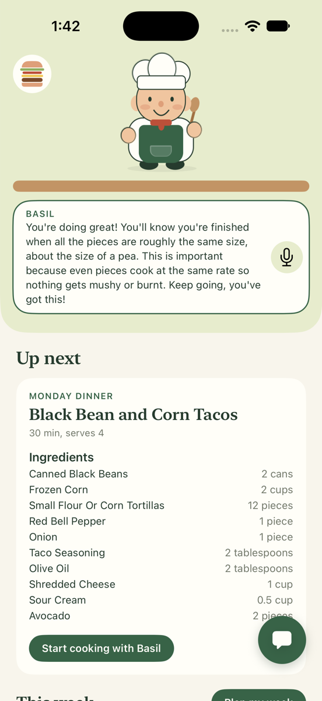
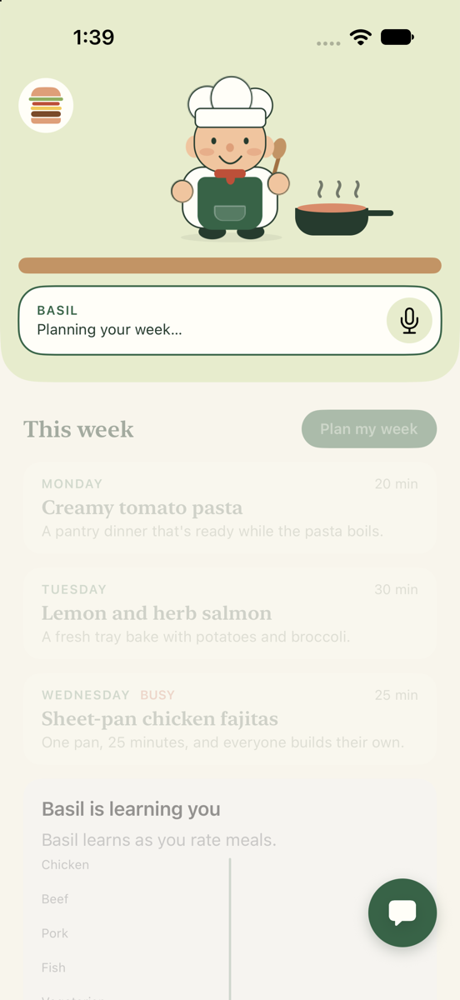
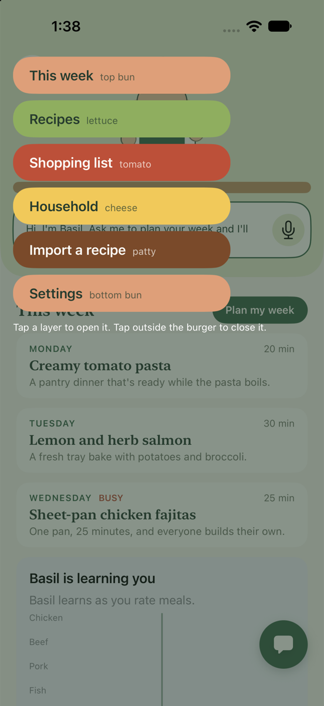
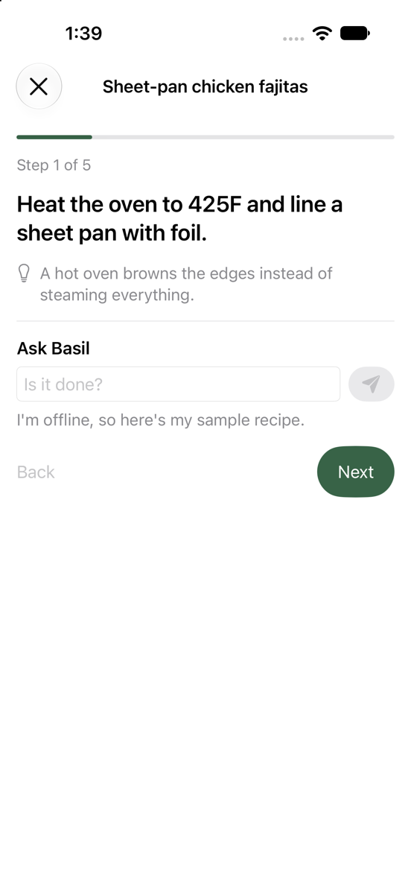
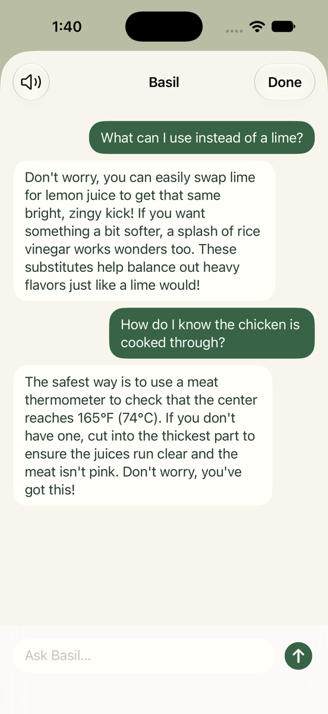
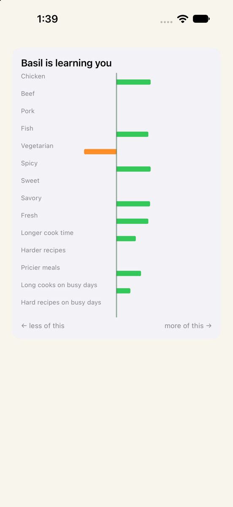
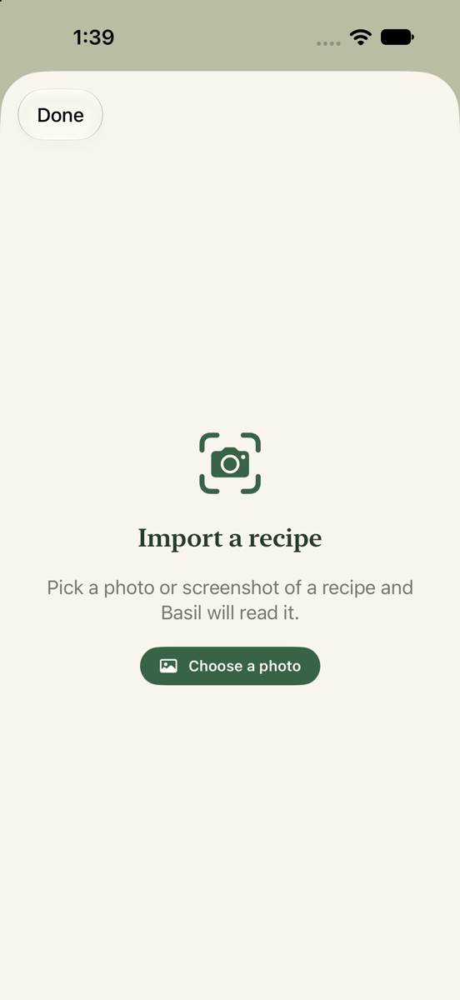

# yeschef!

yeschef! is an iPhone app that plans a household's meals for the week and teaches a beginner to
cook them. A small chef character lives at the top of the screen, and you talk to him by voice or
text. He plans around your family's tastes, allergies, budget and calendar, walks you through each
recipe a step at a time, and learns from what you cook, rate and skip.

We built it at Hacktoberfest Hack Day Raleigh on October 31, 2026.

## What it does

- Plans a week of meals for everyone in the household, each with their own preferences and needs.
- Teaches each recipe in plain words, with timers, and answers questions about a step.
- Builds the shopping list from the week's plan.
- Learns from feedback and keeps suggesting new dishes, using the model described below.

The full list, with what's in the demo and what comes later, is in
[docs/requirements.md](docs/requirements.md).

## Screenshots

<table>
<tr><td align="center"><br>Plan and recipe, live from Gemma</td><td align="center"><br>Basil cooking while Gemma works</td><td align="center"><br>The burger menu</td><td align="center"><br>Cook mode</td></tr>
<tr><td align="center"><br>Chat with Basil</td><td align="center"><br>Basil is learning you</td><td align="center"><br>Import a recipe</td></tr>
</table>

## The model

The app uses Gemma 4 (`gemma-4-26b-a4b-it`), Google's open-weight model, through the Gemini
API. Gemma 4 is released under the [Apache 2.0 license](https://ai.google.dev/gemma/apache_2), and
its use is covered by the [Gemma terms of use](https://ai.google.dev/gemma/terms). Gemma plans the
week, reads recipes from screenshots and links, and answers cooking questions.

## How it learns

Gemma suggests a few recipes for each meal. Allergy and diet rules remove anything unsafe, which
the learning never overrides. A contextual bandit then ranks what's left, which means a model that
balances the dishes it already knows you like against new ones it wants to try. It runs Linear
Thompson Sampling over 15 recipe and day features for each person in the household. Ratings,
cooking a dish, swapping it out and skipping it all count as feedback, and older feedback fades
as tastes change. [.plans/feedback-learning-spec.md](.plans/feedback-learning-spec.md) has the
details.

## Run it

The learning code is a Swift package with no dependencies. Its tests run on macOS or on Linux
with Swift 6.

```bash
cd YesChefCore
swift test
```

A terminal demo plans a few dinners with Gemma, has Basil teach the first one, and then simulates
three weeks of ratings to chart what he learned. Without `GEMINI_API_KEY` it uses the saved sample
plan.

```bash
cd YesChefDemo
GEMINI_API_KEY=your-key-here swift run yeschef-demo
```

The app needs Xcode on a Mac.

1. Create `Config/Secrets.xcconfig` with the line `GEMINI_API_KEY = your-key-here`, using a key
   from <https://aistudio.google.com/apikey>. The file is gitignored. Without it the app still
   builds and runs on its saved sample plan.
2. Open `YesChef.xcodeproj` and run the `YesChef` scheme in an iPhone simulator.

A key built into an app can be pulled out of it, which is fine for a demo. A real release would
need a small server that holds the key.

## Key dependencies

- Swift and SwiftUI, from Apple
- The Gemini API, from Google, serving Gemma 4
- Apple's own frameworks for speech, notifications, the calendar and health data, as each
  feature lands

The app adds no third-party Swift packages.

## Repo layout

- `YesChefCore/`: the Swift package for non-UI code, starting with the learning model
- `docs/`: [requirements](docs/requirements.md) and [architecture](docs/architecture.md), with
  diagrams of the system, the data model, the main flows and the screens
- `.plans/`: the coding checklist and the feedback learning spec
- `.claude/` and `.mcp.json`: the coding-agent skills and the Figma MCP server the team used
  while building

## AI tools we used

- Gemma 4, through the Gemini API, inside the app: it plans the week, writes the recipes, reads
  recipe photos and answers cooking questions.
- Claude Code, to write the code: Claude agents on the MacBook and the Linux laptop wrote the
  Swift, with Figma's MCP server for the designs.

## License

yeschef! is released under the [Apache 2.0 license](LICENSE). The two SwiftUI skills in
`.claude/skills/swiftui-pro` and `.claude/skills/swiftui-expert-skill` come from Paul Hudson and
Antoine van der Lee under the MIT license, with their license files alongside them.
