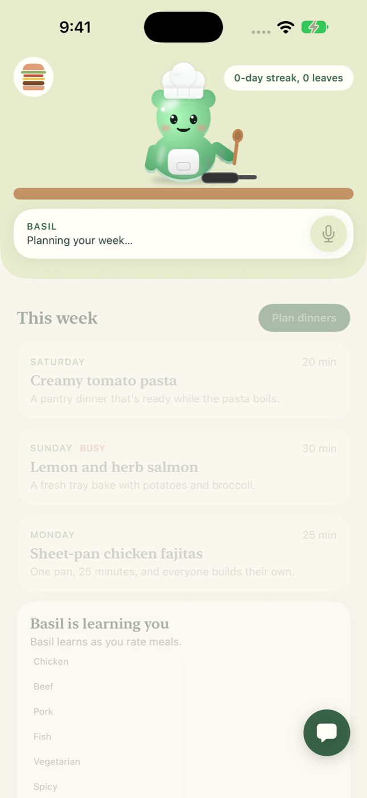
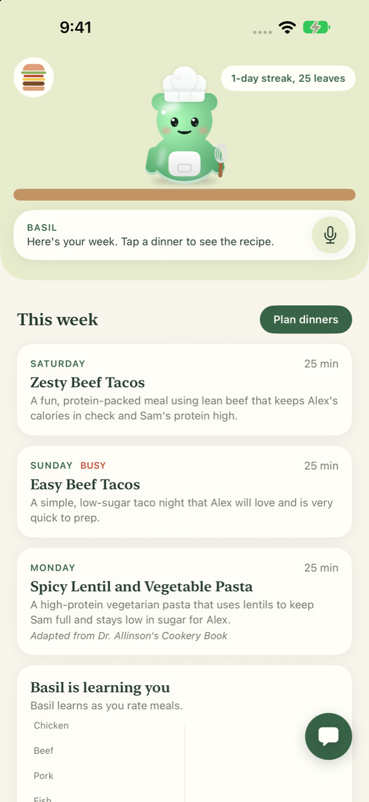
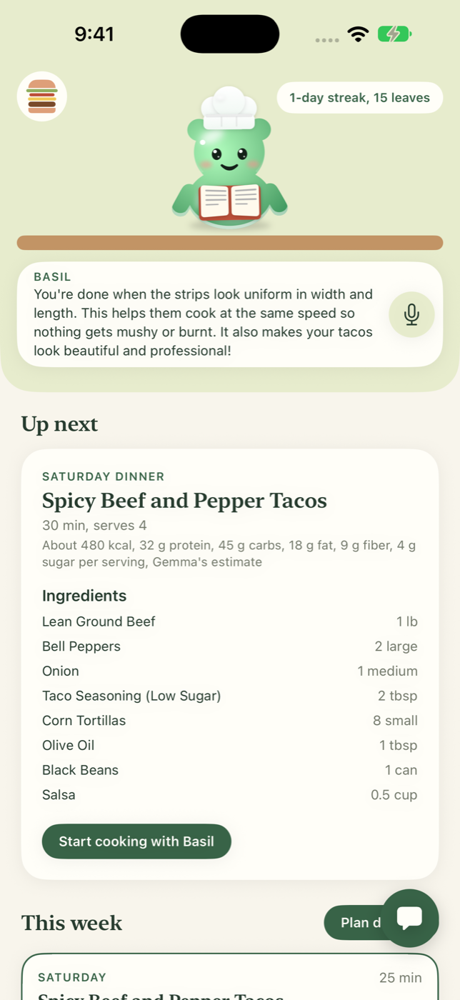

# yeschef!

yeschef! is an iPhone app that plans a household's meals for the week and teaches a beginner to
cook them. A small chef character lives at the top of the screen, and you talk to him by voice or
text. He plans around your family's tastes and allergies, walks you through each recipe a step at
a time, and learns from what you cook and rate.

We built it at Hacktoberfest Hack Day Raleigh on October 31, 2026.

## What it does

- Plans the next few dinners for everyone in the household with Gemma 4, skipping anything a
  member is allergic to or avoids.
- Grounds its ideas in 3,268 recipe passages from six public-domain cookbooks on Project
  Gutenberg, and names the book a dinner was adapted from.
- Teaches each recipe a step at a time, with a plain-words tip and a timer, and answers questions
  about a step, typed or spoken, out loud.
- Reads a recipe from a photo or screenshot.
- Builds the shopping list from the plan.
- Learns from what you cook and rate, and shows what it has learned in "Basil is learning you".

The full list, with what's in the demo and what comes later, is in
[docs/requirements.md](docs/requirements.md).

## Proof of concept

These screenshots come from live runs on October 31, 2026, at about 4:47 PM, in the iPhone 18 Pro
Max simulator on iOS 27.2. The app called `gemma-4-26b-a4b-it` through the Gemini API, and none of
what's on screen is sample data: the dinners, the cookbook it cites, the recipe, the nutrition
estimate and Basil's answer all came back from Gemma during the run.

<table>
<tr>
<td align="center"><br>1. Basil cooks while Gemma plans</td>
<td align="center"><br>2. Three dinners from Gemma, one<br>adapted from a Gutenberg cookbook</td>
<td align="center"><br>3. Gemma's recipe, and Basil<br>answering a question about it</td>
</tr>
</table>

The first run planned the dinners, opened the first recipe and asked Basil a question, with a
screenshot about every 1.4 seconds:

| Step | What happened |
| --- | --- |
| Plan three dinners | They arrived 13 to 14 seconds after launch, from one Gemma call per day running at once. |
| Write the first recipe | It arrived 18 to 20 seconds after the plan, with steps, a technique tip for each and a nutrition estimate. |
| Answer "How do I know when this step is done?" | Basil answered in under 3 seconds. |

The `YesChefCore` tests ran against the live API the same afternoon: 49 tests and 0 failures. Three
of them call Gemma: one plans, writes a recipe and answers a question, one reads a recipe from a
photo, and one is a chat reply that swaps a dinner in the plan.

To repeat it:

- The app: put a key in `Config/Secrets.xcconfig`, run the `YesChef` scheme in a simulator, then
  launch it with `xcrun simctl launch booted com.spheritual.YesChef -demo plan,recipe,ask`. The
  `-demo` argument works in debug builds only.
- The tests: `cd YesChefCore && GEMINI_API_KEY=your-key-here swift test`.

## The model

The app uses Gemma 4 (`gemma-4-26b-a4b-it`), Google's open-weight model, through the Gemini
API. Gemma 4 is released under the [Apache 2.0 license](https://ai.google.dev/gemma/apache_2), and
its use is covered by the [Gemma terms of use](https://ai.google.dev/gemma/terms). Gemma plans the
week, reads recipes from photos and screenshots, and answers cooking questions.

## How it learns

Gemma suggests a few recipes for each meal. Allergy and diet rules remove anything unsafe, which
the learning never overrides. A contextual bandit then ranks what's left, which means a model that
balances the dishes it already knows you like against new ones it wants to try. It runs Linear
Thompson Sampling over 15 recipe and day features for each person in the household. Ratings,
cooking a dish, swapping it out and skipping it all count as feedback, and older feedback fades
as tastes change. [.plans/feedback-learning-spec.md](.plans/feedback-learning-spec.md) has the
details.

## Run it

The learning code is a Swift package with no dependencies. Its tests run on macOS or on Linux
with Swift 6.

```bash
cd YesChefCore
swift test
```

A terminal demo plans a few dinners with Gemma, has Basil teach the first one, and then simulates
three weeks of ratings to chart what he learned. Without `GEMINI_API_KEY` it uses the saved sample
plan.

```bash
cd YesChefDemo
GEMINI_API_KEY=your-key-here swift run yeschef-demo
```

The app needs Xcode on a Mac.

1. Create `Config/Secrets.xcconfig` with the line `GEMINI_API_KEY = your-key-here`, using a key
   from <https://aistudio.google.com/apikey>. The file is gitignored. Without it the app still
   builds and runs on its saved sample plan.
2. Open `YesChef.xcodeproj` and run the `YesChef` scheme in an iPhone simulator.

A key built into an app can be pulled out of it, which is fine for a demo. A real release would
need a small server that holds the key.

## Key dependencies

- Swift and SwiftUI, from Apple
- The Gemini API, from Google, serving Gemma 4
- Apple's own frameworks for speech in and out, notifications and the photo picker
- Six public-domain cookbooks from Project Gutenberg, bundled as recipe passages

The app adds no third-party Swift packages.

## Design

- Diagrams: [docs/design/yeschef.drawio](docs/design/yeschef.drawio), with 13 tabs covering
  context, components, use cases, class diagrams, sequences, Basil's moods, the learning loop,
  deployment, navigation, wireframes and the file structure.
- Exported diagrams: [docs/design/export/](docs/design/export/), with a PNG and an SVG per tab and
  [the whole set as a PDF](docs/design/export/yeschef-design.pdf).
- The code that draws them: [docs/design/build_diagrams.py](docs/design/build_diagrams.py).
- Feature sheet: [docs/design/feature-sheet.md](docs/design/feature-sheet.md).
- Technical details, such as the Thompson sampling, the cookbook search and the allergy checks,
  each linked to its diagram: [docs/technical-details.md](docs/technical-details.md).
- Figma screens, Basil's SVGs, design tokens and Figma's generated screen code:
  [design/](design/README.md).

## Repo layout

- `YesChef/` and `YesChef.xcodeproj/`: the iPhone app
- `Config/`: the build settings, which read the Gemini key from a gitignored `Secrets.xcconfig`
- `YesChefCore/`: the Swift package for the Gemma calls, the cookbook search and the learning
- `YesChefDemo/`: the terminal demo
- `docs/`: [requirements](docs/requirements.md), [architecture](docs/architecture.md), the
  [technical details](docs/technical-details.md), the [design set](docs/design/README.md), the
  [MLH challenge case](docs/mlh-judging.md) and the screenshots, with the live ones in
  `docs/screenshots/live/`
- `design/`: the Figma exports and the team's wireframe mockups
- `.plans/`: the task list and the feedback learning spec
- `.claude/` and `.mcp.json`: the coding-agent skills and the Figma MCP server the team used
  while building
- `.superset/`: the scripts that set up each agent's workspace
- `RESOURCES.MD`: the sources the team chose for Gemma to draw on

## AI tools we used

- Gemma 4, through the Gemini API, inside the app: it plans the week, writes the recipes, reads
  recipe photos and answers cooking questions.
- Claude Code, to write the code: Claude agents on the MacBook and the Linux laptop wrote the
  Swift, with Figma's MCP server for the designs.

## License

yeschef! is released under the [Apache 2.0 license](LICENSE). The two SwiftUI skills in
`.claude/skills/swiftui-pro` and `.claude/skills/swiftui-expert-skill` come from Paul Hudson and
Antoine van der Lee under the MIT license, with their license files alongside them. The cookbook
passages come from six books that are in the public domain in the US, listed in
`YesChefCore/Scripts/build_cookbooks.py`.
