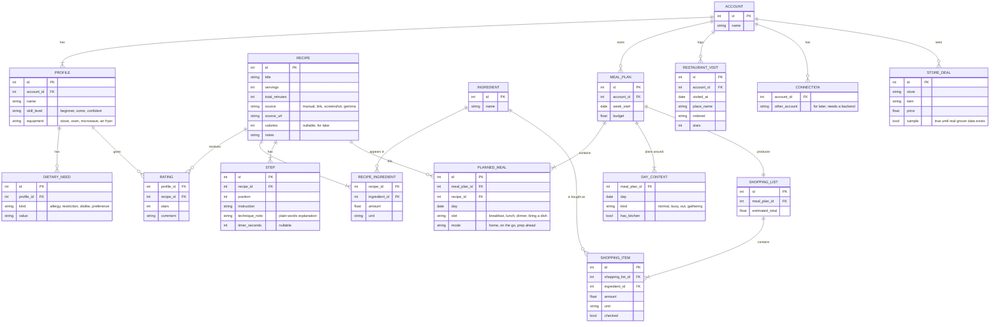
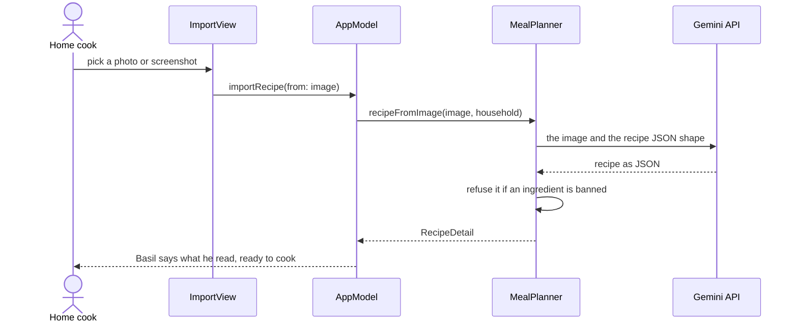

# yeschef! architecture

The diagrams for yeschef! live in the draw.io design set, [docs/design/](design/README.md), with
an exported PNG, SVG and PDF of every tab in [docs/design/export/](design/export/). This page keeps
only what the design set doesn't draw, which is the storage planned for after the hackathon, the
photo import flow, and what data leaves the phone. The TR numbers point to
[requirements.md](requirements.md).

## Data model

The demo keeps everything in memory and saves nothing, which the team decided at 13:22. This is the SQLite schema planned for after the hackathon (TR-05). One account holds several profiles, which is
how a parent keeps a child's preferences apart (BR-09). Calories are nullable on recipes, which
leaves room for health tracking later without building it now. The last three tables are for the
"Later" features and don't get created until those are built.

## Importing a recipe

A photo or screenshot of a recipe goes to Gemma as an image, which is the multimodal part of the
Gemma entry (BR-05). Gemma rewrites it for a beginner, and the planner refuses the result if it
names anything the household must avoid. Reading recipes from web links is planned and not built.

## What leaves the phone

The cookbook search, the allergy rules and the learning all run on the phone (TR-08). How Google
treats prompts on the Gemini API's free tier is unverified, and someone should read the current
terms before real users send data.

| Data | Goes to | When |
| --- | --- | --- |
| Household likes, allergies, diets and busy days, plus matching cookbook passages | Gemini API | Planning |
| A dinner idea, the household and matching cookbook passages | Gemini API | Opening a recipe |
| A recipe photo or screenshot | Gemini API | Importing a recipe |
| The question, the current step and the recipe | Gemini API | Asking Basil |
| Ratings and the preference models | Nowhere | They stay in memory on the phone |
| Calendar events, health data and location | Nowhere | Planned features, not built |
