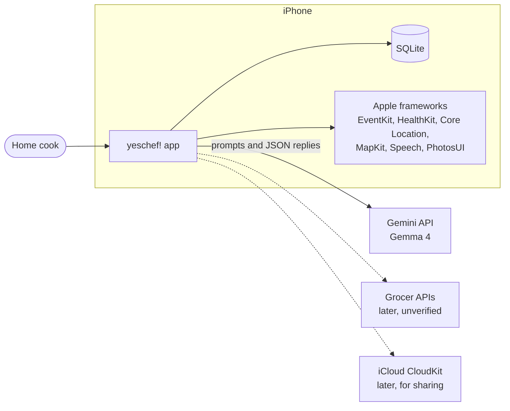
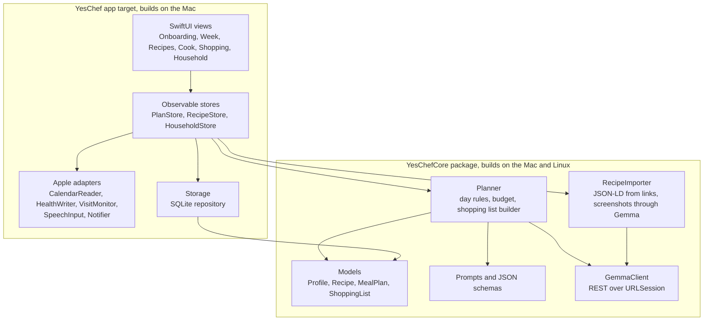
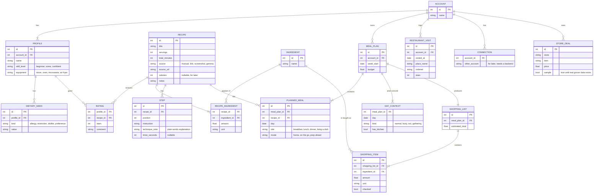
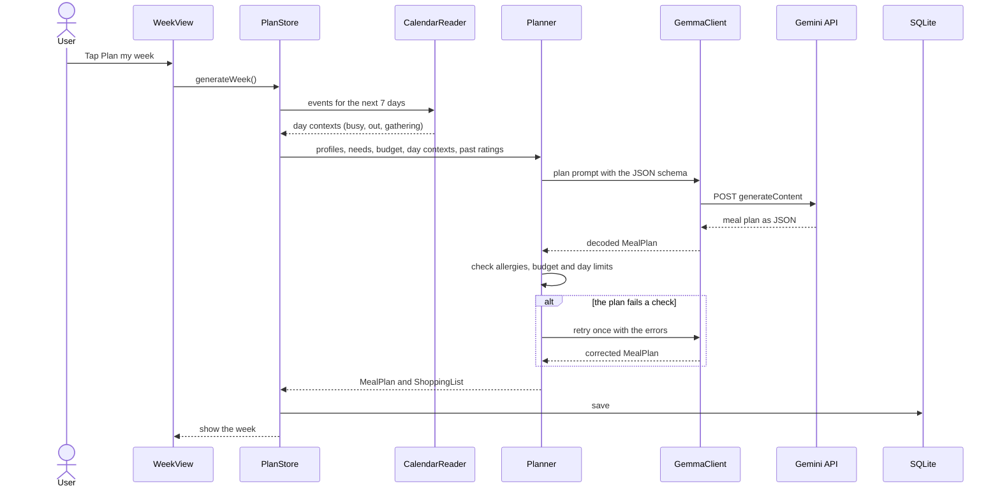
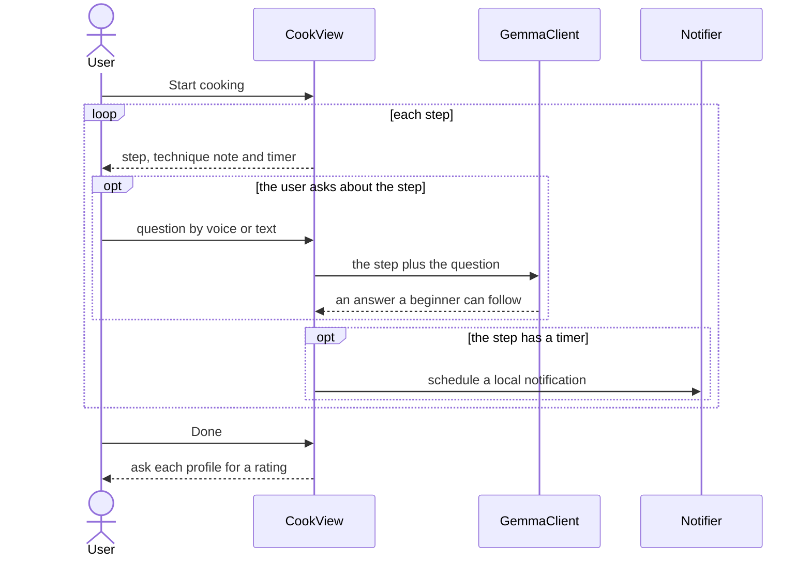
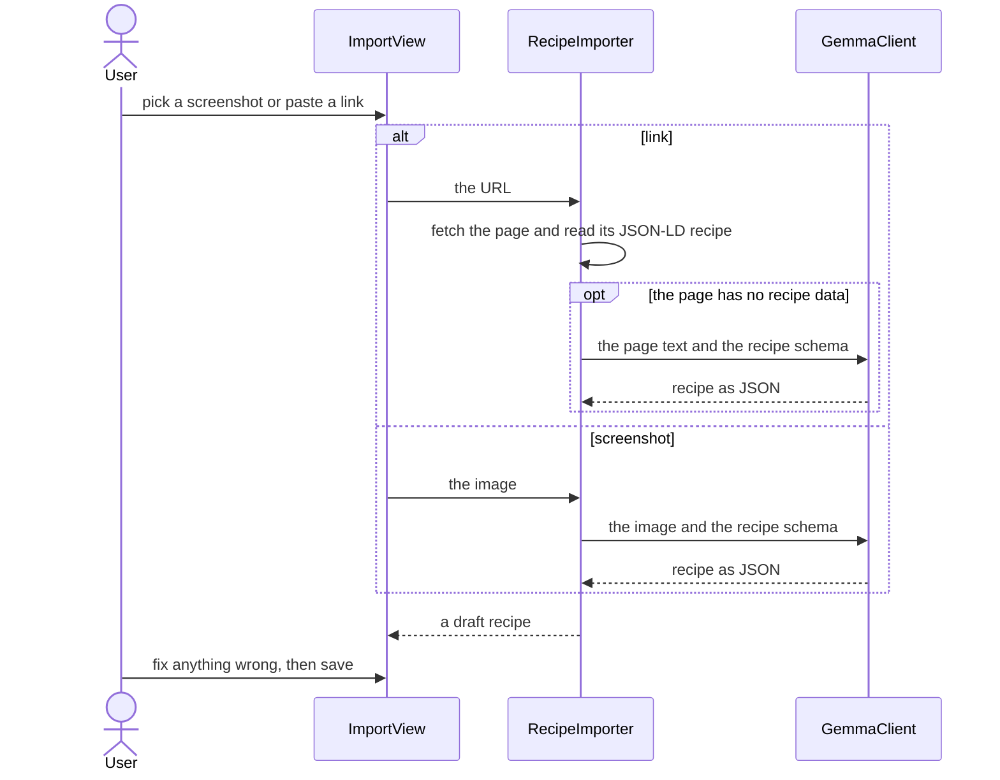
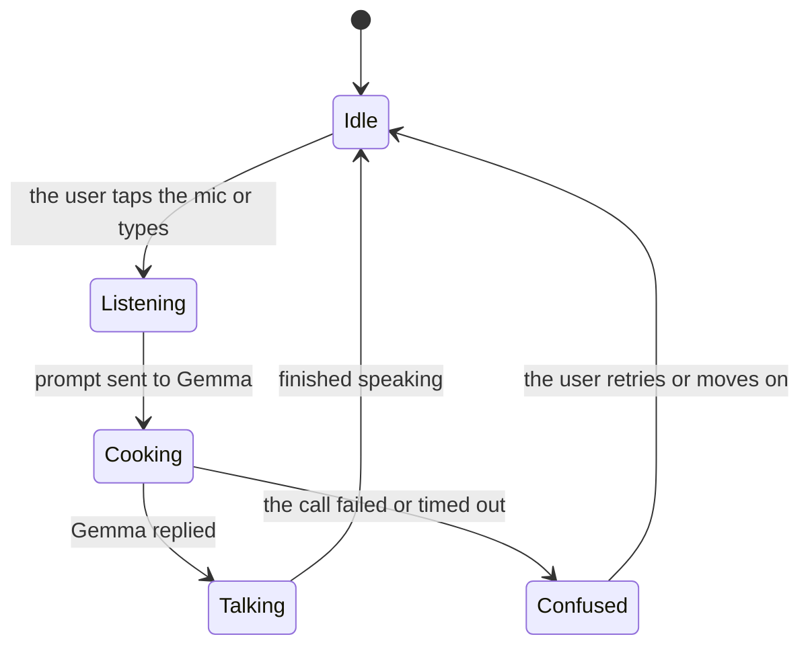
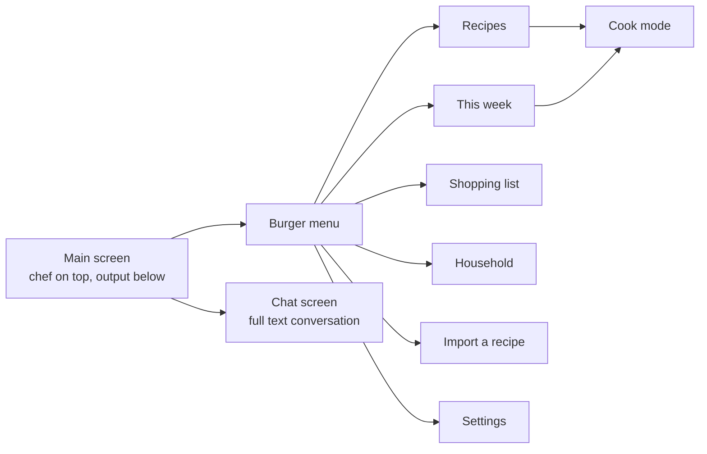

# yeschef! architecture

This page shows how the app is put together. The requirements it builds on are in
[requirements.md](requirements.md), and the TR numbers below point there. Anything the team hasn't
decided yet is marked as open, and the screens stay a proposal until the Figma frames land.

## System context

The app runs on the phone and keeps its data in one SQLite file there. Gemma 4 answers over the
Gemini API. Apple's frameworks give it the calendar, health data, location, voice input and photos.
The dotted lines are for later, since they need grocer access or a sharing backend we don't have.



## Components

The code splits into two parts (TR-06). `YesChefCore` is a Swift package with no UI, which means
it builds and tests on the Linux laptop as well as the Mac. The app target holds the SwiftUI views
and everything that needs an Apple-only framework. If the team picks the sqlite3 library over
SwiftData, the storage code moves into `YesChefCore` too.



## Data model

This is the first pass at the SQLite schema (TR-05). One account holds several profiles, which is
how a parent keeps a child's preferences apart (BR-09). Calories are nullable on recipes, which
leaves room for health tracking later without building it now. The last three tables are for the
"Later" features and don't get created until those are built.



## Planning a week

This is the main flow for the demo (BR-01, BR-04, BR-06). The planner checks Gemma's plan before
saving it, because a model can still suggest peanuts to a profile with a peanut allergy (TR-03).



## Cooking a recipe

Cook mode is where the teaching happens (BR-02). Each step shows its technique in plain words, and
the user can ask about a step by voice or text.



## Importing a recipe

A link goes through the page's own schema.org recipe data first, since many recipe sites publish
it and reading it costs no Gemma call. A screenshot goes to Gemma as an image, which is the
multimodal part of the Gemma entry (BR-05).



## Screens

The app is one main screen built like a Tamagotchi. The chef character lives in the top third,
and the subtitle bar under him is the prompt box. He answers out loud, and the same words show in
the subtitle bar. While Gemma works, he does a cooking animation. The bottom two thirds hold the
recipes and whatever he produced. A round chat bubble in the bottom right opens a text screen with
the full conversation. The menu in the top left is a literal burger, and tapping it fans the layers
out, with each ingredient being one menu option. The Figma frames replace this sketch when they
land.

```text
+--------------------------------------+
| [burger]                             |  menu, top left
|                                      |
|            chef character            |  top third: the chef, cooking
|                                      |  while Gemma works
|  +--------------------------------+  |
|  | Ask the chef              [mic] |  |  subtitle bar: the prompt box,
|  +--------------------------------+  |  which also shows his replies
+--------------------------------------+
|                                      |
|  recipe cards, the week's plan,      |  bottom two thirds: recipes
|  or the current cooking step         |  and output
|                                      |
|                                      |
|                                 (o)  |  chat bubble, bottom right
+--------------------------------------+
```

The burger's layers need names from the design side. This mapping is a placeholder for the code
until then.

| Layer | Opens |
| --- | --- |
| Top bun | This week's plan |
| Lettuce | Recipes |
| Tomato | Shopping list |
| Cheese | Household profiles |
| Patty | Import a recipe |
| Bottom bun | Settings |

The chef's moods drive his animation, and each one maps to a moment in the app.





## What leaves the phone

Everything else stays in the SQLite file on the phone (TR-08). How Google treats prompts on the
Gemini API's free tier is unverified, and someone should read the current terms before real users
send data.

| Data | Goes to | When |
| --- | --- | --- |
| Preferences, dietary needs, budget and a summary of past ratings | Gemini API | Planning a week |
| Day labels from the calendar, plus event titles if the user turns that on | Gemini API | Planning a week |
| A recipe screenshot or the text of a recipe page | Gemini API | Importing a recipe |
| One cooking step and the user's question | Gemini API | Asking about a step |
| Calories and macros | Apple Health, on the phone | After the user allows it |
| Location | Nowhere | Never leaves the phone |

## Files

```text
yeschef/
  README.md
  LICENSE                         Apache-2.0
  CLAUDE.md
  docs/
    requirements.md
    architecture.md
  YesChef.xcodeproj/              made on the Mac
  YesChef/                        app target
    YesChefApp.swift
    Features/
      Onboarding/
      Week/
      Recipes/
      Cook/
      Shopping/
      Household/
    Services/                     Apple adapters
      CalendarReader.swift
      HealthWriter.swift
      VisitMonitor.swift
      SpeechInput.swift
      Notifier.swift
    Storage/
      Database.swift
    Resources/
      Assets.xcassets             character art from Figma
    Secrets.xcconfig              gitignored, holds the Gemini key
  YesChefCore/
    Package.swift
    Sources/YesChefCore/
      Models/
      Planning/
      Gemma/
      Import/
    Tests/YesChefCoreTests/
```
